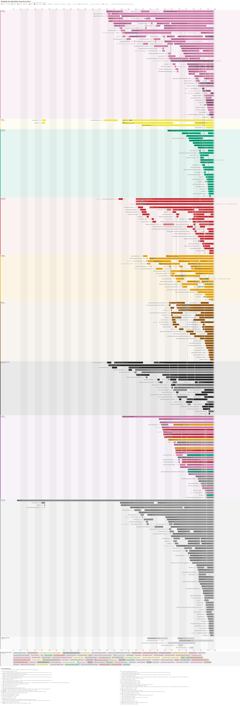

# G-n-aGauche

Arbre généa-phylo-génétique des organisations de gauche en France : filiations, scissions,
fusions, appartenance aux Internationales, et (à venir) passages de militants d'une
organisation à l'autre.

[](arbre.svg)

Cliquer sur l'image pour l'ouvrir en grand. Version interactive (zoom, recherche, parenté au
survol, repli des familles, clé des Internationales) : `data/sortie/arbre.html`, à télécharger
et ouvrir dans un navigateur. Une version par famille, pour l'impression : `data/sortie/arbre_<famille>.svg`.

## Chaîne de traitement

Dépendances : `pip install requests networkx mwparserfromhell` pour les étapes 1 et 2 seulement.
Les étapes 3 à 5 n'utilisent que Python et les caches (aucun réseau, aucune dépendance).

| Étape | Script | Source | Produit |
|---|---|---|---|
| 1 | `arbre.py` | Wikidata (SPARQL) | `data/noeuds.csv`, `data/aretes.csv` |
| 2 | `infobox.py` | Infobox de Wikipédia FR | `data/wp_noeuds.csv`, `data/wp_aretes.csv`, `data/wp_valeurs_sans_lien.csv` |
| 3 | `nettoyage.py` | Les deux + corrections manuelles + caches | `data/sortie/*.csv`, `criteres.md`, `resume.md`, `data/manuel/sigles.csv` |
| 4 | `rendu.py` | Sortie de `nettoyage.py` | `arbre.svg`, `data/sortie/arbre.svg`, `arbre.html`, `arbre_<famille>.svg` |
| 5 | `verifier.py` | Les SVG produits | contrôle des règles R1–R3 ; échoue s'il y a une erreur |

```bash
python arbre.py && python infobox.py          # retéléchargement (rare)
python nettoyage.py && python rendu.py && python verifier.py
```

`data/sortie/criteres.md` explique comment chaque organisation est rangée (graphe, étrangère,
Internationale, exclue) et dans quelle famille ; `data/sortie/resume.md` donne les chiffres.
`data/sortie/anomalies.csv` liste les liens non dessinés parce que leurs dates contredisent le sens
du temps, avec une cause probable : c'est la liste des corrections à faire.

**`data/manuel/sigles.csv`** : sigle et nom court affichés sur chaque barre. À compléter à la main ;
`nettoyage.py` y ajoute les nouvelles organisations sans jamais modifier les lignes existantes.

### Ancienne version (Graphviz)

`fusion.py` puis `arbre_orgs.py` produisent l'ancien rendu Graphviz (`data/arbre_orgs.svg`).

### Options de l'ancienne version

- `infobox.py --refresh`, `fusion.py --refresh` : vident les caches et retéléchargent tout.
- `arbre_orgs.py --tout` : toutes les organisations, même disparues sans descendance actuelle.
  Par défaut, l'arbre part des organisations françaises encore existantes et remonte leurs ancêtres.
- `arbre_orgs.py --sans-internationales` : masque les Internationales.
- `arbre_orgs.py --depuis 1900` : seulement les organisations fondées après cette année.
- `arbre_orgs.py --min-taille 20000` : seulement les « grandes » organisations, celles dont l'article
  Wikipédia fait au moins ce nombre de caractères (plus celles ajoutées dans les corrections).
  Une lignée qui passe par des petites organisations est résumée par un lien gris en tirets.

## Caches

Les fichiers `data/cache_*.json` gardent les données brutes téléchargées. Les CSV sont
recalculés entièrement à chaque exécution à partir de ces caches : on peut modifier le code
d'analyse et relancer en quelques secondes, sans réseau.

## Corrections manuelles

Les CSV produits par les scripts sont **écrasés** à chaque exécution : ne pas les modifier à la main.
Les corrections vont dans deux fichiers, relus à chaque exécution de `nettoyage.py` (et de `fusion.py`) :

**`data/corrections_noeuds.csv`** : `id,action,label,fondation,dissolution,courants,journaux`

- `id` : identifiant Wikidata (`Q...`) ou identifiant libre (`fr:Mon organisation`) pour une
  organisation absente de Wikidata.
- `action` : `inclure`, `exclure`, `vivant` (existe encore) ou `disparu`.
- Les autres colonnes, si remplies, remplacent les données des sources.
  Plusieurs courants ou journaux se séparent par `|`.

**`data/corrections_aretes.csv`** : `ancetre,descendant,type,action`

- `type` : `filiation`, `scission`, `passage` (militants passés d'une organisation à l'autre,
  ex. entrisme) ou `appartenance` (membre d'une Internationale).
- `action` : vide pour ajouter le lien, `supprimer` pour retirer un lien erroné.

## Lecture de l'arbre

- Le temps va de gauche à droite, à l'échelle (13 px par an) ; une barre par organisation, de sa
  fondation à sa fin exactes. Une fin en dégradé : l'organisation existe toujours.
- Voies horizontales par famille : socialistes, radicaux, écologistes, communistes, trotskystes,
  maoïstes, anarchistes et libertaires, outre-mer, non classés, puis organisations étrangères
  et dates inconnues (hors échelle, hachurées).
- Couleur = courant (une teinte par famille, la clarté pour les sous-courants) ; un parti
  d'outre-mer est dans la voie outre-mer mais garde la couleur de son courant.
- Liens, toujours vers la droite : trait plein (renommage, filiation, fusion, avec une barre de
  réunion), tirets rouges avec une fourche au départ (scission), pointillés bleus (passage de
  militants). Un chevron sur une barre : renommage sur la même rangée. Un lien trop long (plus de
  40 ans ou de 2 voies) devient un renvoi écrit : « → NPA » d'un côté, « issu de : LCR » de l'autre.
- Les Internationales ne sont pas des organisations de l'arbre : une bande fine sous la barre du
  parti membre (hachurée : période inconnue) et un badge avec le sigle. Voir la clé sous la frise.
