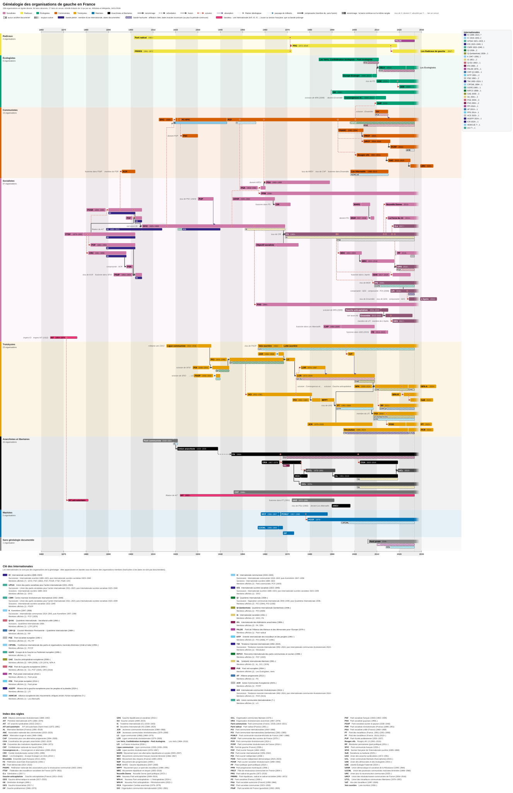

# G-n-aGauche

Arbre généa-phylo-génétique des organisations de gauche en France : filiations, scissions,
fusions, appartenance aux Internationales, et (à venir) passages de militants d'une
organisation à l'autre.

[](arbre.svg)

Cliquer sur l'image pour l'ouvrir en grand. Version interactive (zoom, recherche, parenté au
survol, repli des familles, clé des Internationales) : [`arbres/arbre.html`](arbres/arbre.html), à télécharger
et ouvrir dans un navigateur. Une version par famille, pour l'impression : [`arbres/`](arbres/).

## Où trouver quoi

| Dossier | Contenu |
|---|---|
| [`arbres/`](arbres/) | tous les arbres : complet, par famille, version interactive, vue des Internationales |
| [`data/`](data/) | données : brutes (racine), `manuel/` (à remplir à la main), `sortie/` (tables produites), `ancien/` |
| [`scripts/`](scripts/) | la chaîne de traitement (Python) ; `scripts/ancien/` : l'ancienne version Graphviz |

## Chaîne de traitement

Dépendances : `pip install -r requirements.txt` (requests et mwparserfromhell pour la collecte, cairosvg pour
l'affiche PDF, networkx facultatif). Les étapes 3 à 5 n'utilisent que Python et les caches (aucun réseau).
Polices de l'affiche (licence libre OFL, fichier OFL.txt à côté de chaque famille) : `fonts/` (Fraunces,
Barlow Condensed, IBM Plex Mono), téléchargées depuis le dépôt github.com/google/fonts.

| Étape | Script | Source | Produit |
|---|---|---|---|
| 1 | `scripts/arbre.py` | Wikidata (SPARQL) | `data/noeuds.csv`, `data/aretes.csv` |
| 2 | `scripts/infobox.py` | Infobox de Wikipédia FR | `data/wp_noeuds.csv`, `data/wp_aretes.csv`, `data/wp_valeurs_sans_lien.csv` |
| 3 | `scripts/enrichissement.py` | Textes Wikipédia, pages liées, Wikidata | `data/manuel/actifs.csv`, `data/sortie/liens_candidats.csv`, `liste_recherche.csv` |
| 3b | `scripts/tableaux.py` | Tableaux des membres des Internationales (articles en et fr) | `data/sortie/affiliations_tableaux.csv` : années d'adhésion des organisations françaises, avec la ligne du tableau en citation |
| 4 | `scripts/nettoyage.py` | Sources + fichiers de `data/manuel/` + caches | `data/sortie/*.csv` (dont `elagues.csv`), `criteres.md`, `resume.md`, `data/manuel/types.csv` |
| 5 | `scripts/rendu.py` | Sortie de `nettoyage.py` | `arbre.svg` (racine), et dans `arbres/` : `arbre.svg`, `arbre.html`, `arbre_<famille>.svg`, `arbre_apercu.svg`, `vue_internationales.svg/.html` |
| 6 | `scripts/verifier.py` | Les SVG produits et les CSV | rapport complet (R1 à R8, croisements, étiquettes en double, citations introuvables…) ; échoue si un compteur n'est pas à zéro |

`scripts/preuves.py` (utilisé par les étapes 3 à 6) : chaque lien, affiliation ou succession d'Internationales
s'appuie sur une citation mot pour mot du wikitexte en cache (règle R8), revérifiée par `verifier.py`.
Fichiers de contrôle dans `data/sortie/` : `liens_sans_preuve.csv`, `affiliations_sans_preuve.csv`,
`anomalies.csv`, `a_dater.csv`, `elagage_rejets.csv`, `elagues.csv`, `liste_recherche.csv`, `actifs_a_revoir.csv`.
`elagage_rejets.csv` est le journal exhaustif : une ligne par candidat des sources brutes (Wikidata,
Wikipédia, nœuds manuels) non dessiné (`id, label, actif, famille_si_connue, raison, lien_manquant, source`).
`couverture.csv` dit, pour chaque incontournable et pour Place publique, s'il a été collecté et pourquoi il
est dessiné ou non ; `branches_eteintes.csv` liste les incontournables dessinés sans descendance active.

```bash
python scripts/arbre.py && python scripts/infobox.py    # retéléchargement (rare)
python scripts/enrichissement.py                        # liens candidats à valider (réseau, mis en cache)
python scripts/tableaux.py                              # adhésions lues dans les tableaux des Internationales (réseau, mis en cache)
python scripts/nettoyage.py && python scripts/rendu.py && python scripts/verifier.py
```

### Fichiers à remplir à la main (`data/manuel/`, jamais écrasés)

| Fichier | Rôle |
|---|---|
| `actifs.csv` | `valide = oui` / `non` : organisations qui existent aujourd'hui |
| `types.csv` | type de chaque organisation (parti, coalition, satellite…) |
| `aretes_manuelles.csv` | liens ajoutés à la main, source obligatoire ; type `composante` (membre de) ou `supprimer` (retire un lien automatique erroné) |
| `noeuds_manuels.csv` | dates, nom ou courants corrigés (ou organisation ajoutée), source et citation obligatoires |
| `origines.csv` | origines historiques dessinées même sans descendance active (ex. la Première Internationale), raison et source obligatoires |
| `affiliations_dates.csv` | dates d'adhésion aux Internationales, source obligatoire |
| `sigles.csv` | sigle et nom court affichés dans les étiquettes |

Et dans `data/sortie/liens_candidats.csv`, `decision = oui` sur les liens proposés à garder. Pour commencer : `data/sortie/liens_candidats_a_lire.csv`, un extrait court (confiance élevée, organisation dessinée, lien pas encore tracé) ; la colonne `ligne` donne la ligne à modifier dans le grand fichier.
L'arbre ne montre que les organisations en lignée directe d'une organisation active (règle R5),
sauf les origines historiques listées dans `data/manuel/origines.csv` et les incontournables
(`data/manuel/incontournables.csv`), dessinés au besoin en « branche éteinte » avec leurs seuls liens documentés.

`data/sortie/criteres.md` explique comment chaque organisation est rangée (graphe, étrangère,
Internationale, exclue) et dans quelle famille ; `data/sortie/resume.md` donne les chiffres.
`data/sortie/anomalies.csv` liste les liens non dessinés parce que leurs dates contredisent le sens
du temps, avec une cause probable : c'est la liste des corrections à faire.

**`data/manuel/sigles.csv`** : sigle et nom court affichés sur chaque barre. À compléter à la main ;
`nettoyage.py` y ajoute les nouvelles organisations sans jamais modifier les lignes existantes.

### Ancienne version (Graphviz)

Rangée à part : `scripts/ancien/arbre_orgs.py` et ses fichiers (`data/ancien/`), plus maintenue. `scripts/fusion.py` reste dans la chaîne : `nettoyage.py` s'en sert.

### Options de l'ancienne version

- `infobox.py --refresh`, `fusion.py --refresh` : vident les caches et retéléchargent tout.
- `arbre_orgs.py --tout` : toutes les organisations, même disparues sans descendance actuelle.
  Par défaut, l'arbre part des organisations françaises encore existantes et remonte leurs ancêtres.
- `arbre_orgs.py --sans-internationales` : masque les Internationales.
- `arbre_orgs.py --depuis 1900` : seulement les organisations fondées après cette année.
- `arbre_orgs.py --min-taille 20000` : seulement les « grandes » organisations, celles dont l'article
  Wikipédia fait au moins ce nombre de caractères (plus celles ajoutées dans les corrections).
  Une lignée qui passe par des petites organisations est résumée par un lien gris en tirets.

## Caches

Les fichiers `data/cache_*.json` gardent les données brutes téléchargées. Les CSV sont
recalculés entièrement à chaque exécution à partir de ces caches : on peut modifier le code
d'analyse et relancer en quelques secondes, sans réseau.

## Corrections manuelles

Les CSV produits par les scripts sont **écrasés** à chaque exécution : ne pas les modifier à la main.
Les corrections vont dans deux fichiers, relus à chaque exécution de `nettoyage.py` (et de `fusion.py`) :

**`data/corrections_noeuds.csv`** : `id,action,label,fondation,dissolution,courants,journaux`

- `id` : identifiant Wikidata (`Q...`) ou identifiant libre (`fr:Mon organisation`) pour une
  organisation absente de Wikidata.
- `action` : `inclure`, `exclure`, `vivant` (existe encore) ou `disparu`.
- Les autres colonnes, si remplies, remplacent les données des sources.
  Plusieurs courants ou journaux se séparent par `|`.

**`data/corrections_aretes.csv`** : `ancetre,descendant,type,action`

- `type` : `filiation`, `scission`, `passage` (militants passés d'une organisation à l'autre,
  ex. entrisme) ou `appartenance` (membre d'une Internationale).
- `action` : vide pour ajouter le lien, `supprimer` pour retirer un lien erroné.

## Lecture de l'arbre

- Le temps va de gauche à droite, à l'échelle (13 px par an) ; une barre par organisation, de sa
  fondation à sa fin exactes. Une fin en dégradé : l'organisation existe toujours. Une barre
  récente trop courte pour son étiquette la porte après aujourd'hui (ex. NPA-A, L'Après).
- Composante (membre de, sans fusion) : trait gris foncé vertical entre les deux barres, un point
  à chaque bout (ex. PG et LFI). Les coalitions (Front de gauche, NUPES…) ne sont pas dessinées.
- Voies horizontales par famille : socialistes, radicaux, écologistes, communistes, trotskystes,
  maoïstes, anarchistes et libertaires, outre-mer, non classés, puis organisations étrangères
  et dates inconnues (hors échelle, hachurées).
- Couleur = courant (une teinte par famille, la clarté pour les sous-courants) ; un parti
  d'outre-mer est dans la voie outre-mer mais garde la couleur de son courant.
- Liens, toujours vers la droite : trait plein (renommage, filiation, fusion, avec une barre de
  réunion), tirets rouges avec une fourche au départ (scission), pointillés bleus (passage de
  militants). Un chevron sur une barre : renommage sur la même rangée. Un lien trop long (plus de
  40 ans ou de 2 voies) devient un renvoi écrit : « → NPA » d'un côté, « issu de : LCR » de l'autre.
- Exceptions voulues (`data/manuel/origines.csv`) : la Première Internationale (AIT) et sa branche
  anti-autoritaire, dessinées en bandeaux (le style des bandes d'affiliation), et trois Internationales
  dessinées en bandeau avant la naissance de leur section française, sur la rangée de celle-ci : la
  bande de la section prolonge le bandeau (IO 1889, puis SFIO 1905 à 1914 ; IC 1919, puis PC-SFIC
  1921 à 1943 ; AIT de 1922, puis CNT).
- Les autres Internationales ne sont pas des organisations de l'arbre : une bande fine sous la barre du
  parti membre (hachurée : dates exactes inconnues) et un badge avec le sigle. Des adhésions
  successives partagent une ligne (SFIO : IO, puis UPSAI, puis IOS, puis IS). Voir la clé sous la
  frise, puis l'index des sigles des organisations.
- Adhésions : citées par l'article de l'organisation, ou par le tableau des membres de
  l'Internationale (ex. en:Second International : POF, FTSF, CRC 1889 à 1902, POSR 1890 à 1902,
  PSF et PSdF 1902 à 1905) ; les années du tableau priment, sauf dates saisies à la main.
- Noms successifs d'une même organisation (champ « fondation » de l'infobox : « 1920 (SFIC),
  1921 (PC-SFIC), 1943 (PCF) ») : un trait blanc à chaque date et le nouveau nom dans la barre.
